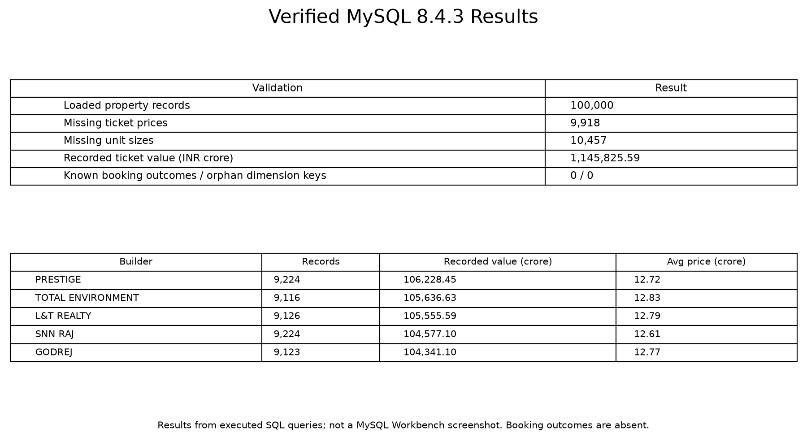
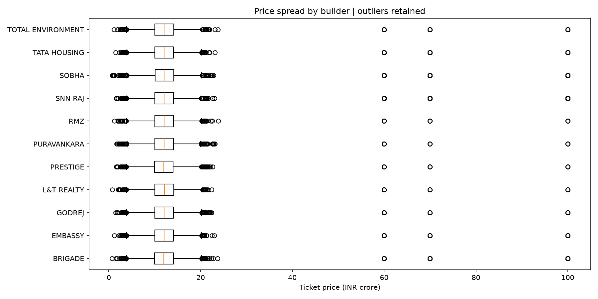
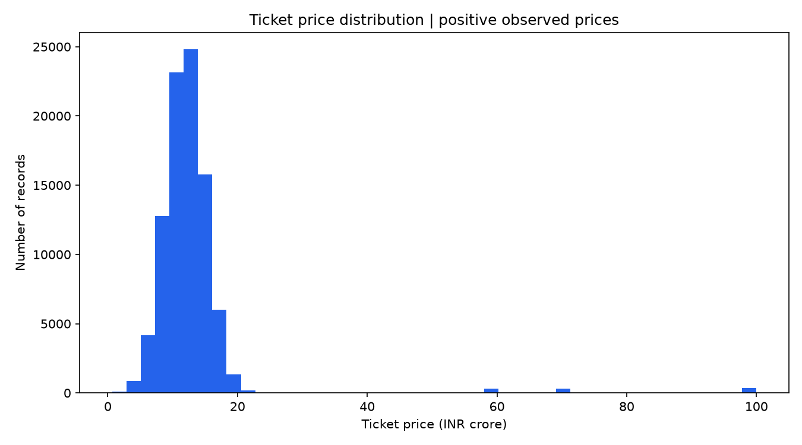
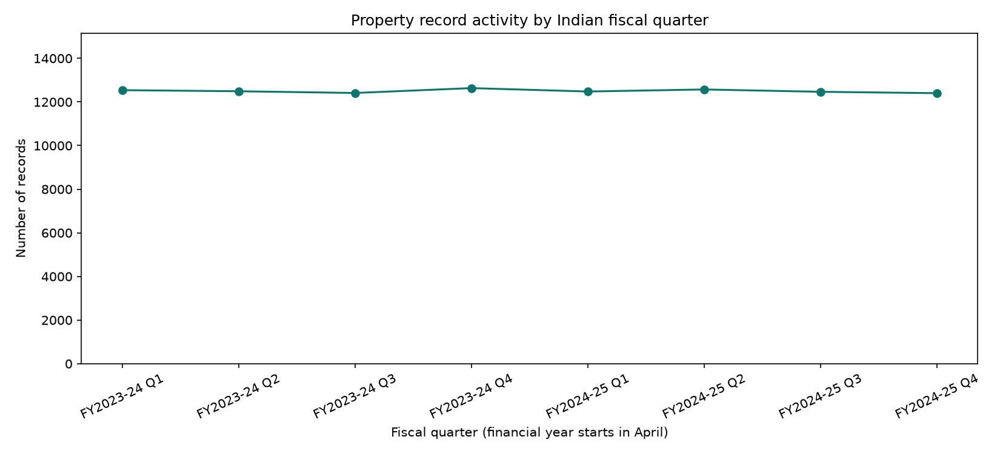
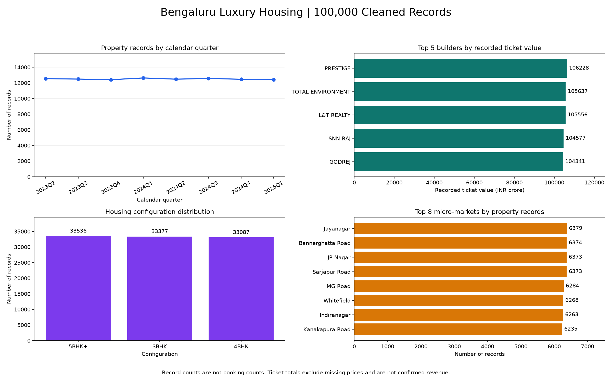
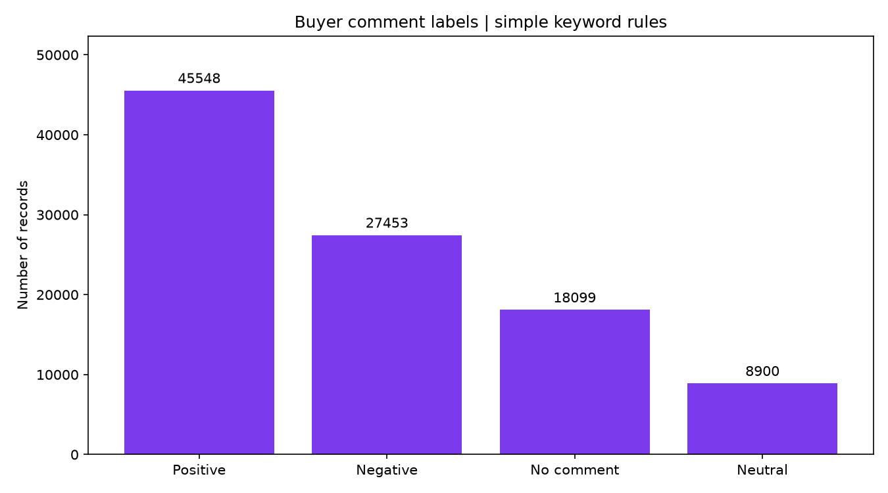
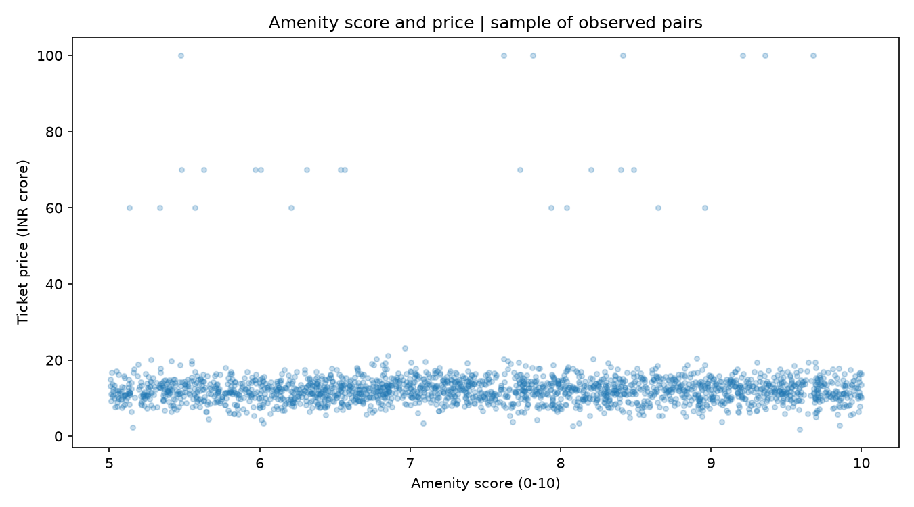
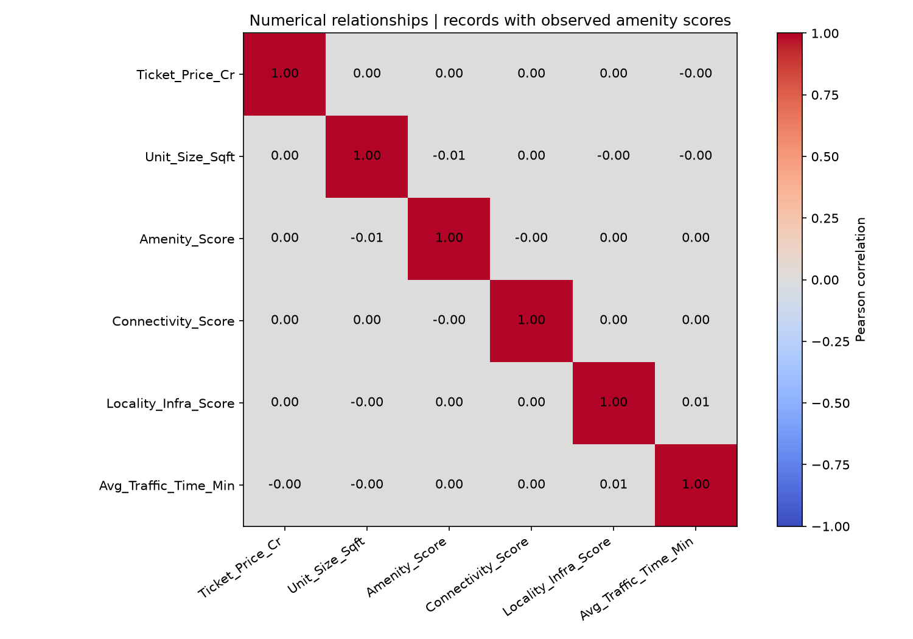

# Luxury Housing Sales Analysis - Bengaluru

## Purpose and workflow

This project explores the housing dataset supplied by the course. It describes
locality activity, builder pricing, configuration distribution, sales channels,
buyer composition, and feedback. Python prepares the data, MySQL stores and
validates it, and the Power BI project defines an interactive reporting model.

The source is the CSV linked in the course brief, inspected on 2 November 2026.
It has 101,000 rows and 18 columns. Removing 1,000 exact repeated rows leaves
100,000 distinct property records, 11 builders, 16 localities, and eight quarters
covering April 2023 through March 2025. Representativeness of the source has not
been established; these findings describe this dataset rather than the entire
Bengaluru housing market.

## Data preparation decisions

Builder names are standardized to uppercase and locality names are normalized.
`Developer_Name` becomes `Builder`; property identifiers and project names are
retained. Currency labels are removed from crore prices before numeric conversion.
Dates become proper date values.

Missing or non-positive prices and unit sizes remain missing. Missing categories
use Unknown; absent comments use No comment. The median fills missing amenity
scores, with an original-missing flag. Analyses of observed amenity relationships
exclude these filled values.

Price per square foot uses `Ticket_Price_Cr * 10000000 / Unit_Size_Sqft`.
Calendar quarters and Indian April-March financial years are both provided.
An IQR flag identifies price review candidates while preserving the observations.
Simple, documented keywords label comments as Positive, Negative, Neutral, Mixed,
or No comment. This is not a trained sentiment model.

| Coverage measure | Result |
|---|---:|
| Cleaned property records | 100,000 |
| Available ticket prices | 90,082 (90.082%) |
| Missing ticket prices | 9,918 |
| Missing unit sizes | 10,457 |
| Available price-per-square-foot values | 80,614 |
| Amenity scores filled with median | 10,000 |
| Price records flagged by IQR | 1,552 |
| Records with no buyer comment | 18,099 |
| Known booking outcomes | 0 |

## SQL implementation and verification

MySQL 8.4.3 contains `housing_sales`, `dim_builder`, `dim_market`, and
`dim_quarter`. Property_ID is the housing primary key; the three lookup keys
are unique. Indexes support builder, market, and fiscal-quarter filtering.

The pipeline loaded all 100,000 records. SQL and pandas agree on row counts,
missing values, and the recorded ticket total within a tolerance of 0.0001 crore.
The three dimension joins have zero orphan records. Seventeen queries were
executed and their outputs are included in `sql_results/`.

The full SQL export was restored into a second fresh database. Its record count,
ticket total, and absence of booking outcomes match the source database.
Machine-readable evidence is included in `validation_summary.json` and
`restore_validation.json`.

This image presents actual query results; it is not a screenshot of MySQL Workbench.

## Main findings

### Builders and prices

The recorded ticket total is **1,145,825.59 crore**, summing the 90,082 available
prices. The average available price is **12.72 crore**, and the median is
**12.04 crore**. Positive prices range from **0.66 to 100 crore**.
The higher mean and extreme values motivate outlier review rather than automatic
deletion. The total is not confirmed sales revenue.

| Top builder by recorded ticket value | Value (crore) |
|---|---:|
| Prestige | 106,228.45 |
| Total Environment | 105,636.63 |
| L&T Realty | 105,555.59 |
| SNN Raj | 104,577.10 |
| Godrej | 104,341.10 |

Sobha has the highest average observed ticket price at about **12.89 crore**.
Recorded totals depend on property volume and price completeness as well as
price level. They should not be used alone to judge booking success.

### Quarter and configuration patterns

Quarterly counts range from **12,403 to 12,635** records. The source shows fairly
steady quarterly activity with limited count variation. Eight quarters are too
few to establish robust recurring seasonality or make strong forecasts.

The three configurations are close to balanced: **5BHK+ 33,536**, **3BHK 33,377**,
and **4BHK 33,087** records. This is observed composition, not proof of purchase
preference or booking demand.

### Localities, channels, and buyers

Jayanagar has the most property records (**6,379**), followed by Bannerghatta Road
(**6,374**). Sarjapur Road and JP Nagar each have **6,373**. These differences
are small; record counts alone do not identify superior investment returns.

Channel volumes are Online **25,169**, Broker **25,124**, NRI Desk **25,032**, and
Direct **24,675**. The near-balanced distribution supports comparison, but
successful booking efficiency cannot be measured from this source.

Buyer groups and possession statuses are also close to balanced. The included
cross-tabs show buyer composition within possession status. They do not show
how possession causes booking decisions.

Keyword feedback labels are Positive **45,548**, Negative **27,453**, Neutral
**8,900**, and No comment **18,099**. Missing feedback and simple keyword rules
limit interpretation. Comments mentioning agent responsiveness, commute
distance, and connectivity suggest topics for qualitative service review.

### Amenities and numerical relationships

Among **81,084** complete pairs with originally observed amenity scores, the
Pearson correlation between amenity score and ticket price is approximately
**0.002**. This provides little evidence of a linear relationship in this source.
It does not determine whether amenities affect booking conversion.

The scatter displays a reproducible sample of 2,000 complete observed pairs for
readability; the reported correlation uses all 81,084 complete pairs. The heatmap
uses pairwise available observations among records with observed amenity scores,
so pair counts for other correlations can differ.

## Coverage of the ten dashboard questions

| Brief question | Available analysis and limitation |
|---|---|
| Quarter-by-market booking trends | Fiscal-quarter record trends prepared; actual bookings unavailable |
| Builder total and average ticket values | SQL results, charts, and Power BI table prepared |
| Amenity score versus booking success | Observed amenity/price analysis prepared; booking relationship unavailable |
| Market booking conversion | Measures prepared to stay blank until real outcomes exist |
| Configuration demand | Configuration record distribution available; booking demand unavailable |
| Channel booking efficiency | Channel record volume available; successful booking efficiency unavailable |
| Quarterly builder contribution | Fiscal-quarter builder-value matrix prepared |
| Possession, buyer type, and bookings | Possession/buyer composition available; booking decisions unavailable |
| Project geography | Locality counts and map definition prepared; project-name uniqueness/geocoding limited |
| Top five revenue/booking performers | Top five recorded ticket values available; realized revenue/booking success unavailable |

## Power BI model and verification boundary

The editable project is `PowerBI/LuxuryHousing.pbip`. It has four report pages,
48 visual containers, 22 DAX measures, three dimension relationships, and
builder/market/fiscal-quarter slicers on every page. Pages cover market overview,
markets and buyers, pricing and quality, and booking-data limitations.

The report definitions pass Microsoft JSON-schema validation. Field names,
relationship references, and visual bounds were checked. Microsoft's Tabular
Object Model successfully deserializes the four-table semantic model.

**Native Power BI rendering, DAX execution, and refresh have not been verified,
because Power BI Desktop is not installed here.** No `.pbix` or genuine Power BI
screenshots are included. Open and refresh the `.pbip`, verify the measures and
visuals, and save the required desktop report before claiming final completion.

The native MySQL connector uses Import and refresh. Instructor clarification is
needed if the phrase "live connection" requires true DirectQuery.

## Recommended business use and next data requirements

Use prices with their coverage counts, review high-price observations, and compare
builder averages alongside volume. Investigate the negative feedback themes using
the original comments. Keep inferred comment labels separate from confirmed
customer sentiment.

Obtain genuine booking status, inquiry/lead identifiers, outcome dates, stable
project identifiers, verified geographic coordinates, and realized transaction
values for booking conversion, funnel drop-off, accurate project maps, and revenue
analysis. Confirm the source's sampling and provenance before generalizing.

## Remaining submission actions

Verify the report in Power BI Desktop, capture native screenshots, and save the
required format. Confirm the missing-booking-data treatment with the instructor.
The project is published at https://github.com/Harikesavachellam/luxury-housing-sales-analysis.
Submit that URL through the course portal and booking form after completing
the remaining verification steps. Portal submission and booking have not been performed.
